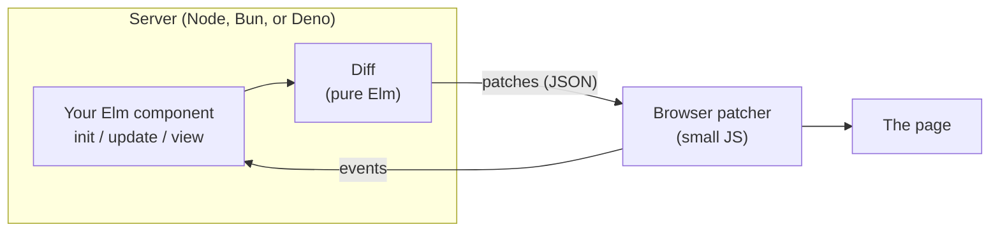

# Jorn

**Write your UI once in Elm. Run each piece in the browser, on the server, or both, and decide at deploy time. Ship new versions without your users noticing.**

Jorn is an attempt to build the web framework that doesn't make you choose. Today every serious option wins on one axis by giving up another. Jorn's bet is that with the right language, you can have all of them at once.

> **Status: v0.0.** The foundation is built and tested: a pure Elm virtual DOM, a diff, a JSON wire protocol, event routing, and the small browser script that applies patches to the page. The rest of this page describes where it's going. See the [roadmap](ROADMAP.md).

## What v0.0 gives you

A virtual DOM that is ordinary Elm data, so a `view` can be diffed anywhere: in the browser, in a Node process, or on a server streaming patches to a browser.

```elm
import Jorn.Element as Element exposing (Element)
import Jorn.Element.Html as Html
import Jorn.Event exposing (onClick)
import Jorn.Patch

view : Int -> Element Msg
view count =
    Html.button [ onClick Increment ] [ Element.text (String.fromInt count) ]

patches =
    Jorn.Patch.diff (view 1) (view 2)
-- one patch: set the button's text to "2"
```

| Module | What it does |
|---|---|
| `Jorn.Element`, `Jorn.Element.Html`, `Jorn.Attribute`, `Jorn.Event` | Build views. Ordinary Elm data, like `elm/html`. |
| `Jorn`, `Jorn.Effect` | Run an app in the page: `init`, `update`, `view`, and effects. |
| `Jorn.Patch` | Diff two views and encode the patches as JSON. |
| [`client/jorn.js`](client/jorn.js) | The browser side: apply patches to the DOM and report events back. No dependencies. |

[examples/todos](examples/todos) is a complete app, written the way Jorn apps are meant to be. Underneath, the page and the program only exchange JSON: events go in, and only what changed comes back out. A click and a keystroke look like this:

```
page -> app {"path":[4],"name":"click","event":{}}
app -> page {"patches":[{"op":"set-text","path":[3,0],"text":"1"}]}

page -> app {"path":[1],"name":"input","event":{"target":{"value":"Jorn"}}}
app -> page {"patches":[{"op":"set-text","path":[0,0],"text":"Hello, Jorn"},{"op":"set-attr","path":[1],"name":"value","value":"Jorn"}]}
```

That's what will let the same program run on a server later, with a websocket in between.

The wire format is specified in [PROTOCOL.md](PROTOCOL.md).

### Using it

Jorn isn't on the Elm package registry yet. To try it, clone this repo, add its `src` folder to your application's `source-directories` in `elm.json` alongside a dependency on `elm/json`, and load `client/jorn.js` in your page. [examples/todos](examples/todos) shows the wiring.

## The problem, in plain terms

When you build a web app today, you make an early, expensive decision about **where your UI runs**.

- **In the browser** (React, Vue, Svelte, classic Elm). Fast, interactive, works offline. But you ship a lot of JavaScript, you build an API layer to talk to your server, and you keep the two sides in sync by hand.
- **On the server** (Hotwire, Laravel Livewire, and the like). The server holds the state and streams small HTML updates over a websocket. Barely any client code and no API layer. But every click is a round trip, and when you deploy, connected users lose their session state.
- **A mix** (React Server Components, Next.js). Pick per component. In practice the boundary between "server" and "client" code is a constant source of bugs, because the language can't tell you what's safe to send across it.

And whichever you pick, you also maintain the glue: REST or GraphQL schemas, serializers, versioning, and deploy choreography so old clients don't break against new servers.

## The claim

Jorn aims to be the first framework that does all three of these together:

**1. Components that can run anywhere, unchanged.** The same component runs as a browser app, as a server component streaming updates, or as static HTML that wakes up in the browser. Moving it between those is a configuration change, not a rewrite. The compiler rejects any placement that would send something across the network that can't be sent.

**2. No API layer.** Client and server share types. The data that crosses the network is checked by the compiler, and the code to encode and decode it is generated. No REST endpoints to design, no schemas to keep in sync, no "the server changed and the client didn't" bugs in production.

**3. Deploys that don't drop anyone.** When you ship a new version, every connected user keeps their state. Their session is migrated to the new version through a migration function the compiler has proven handles every case. Today that's somewhere between hard and impossible in every mainstream framework.

The concrete bar: match the best server-component frameworks at live, server-rendered UI, Lamdera at type-safe full stack, and React at client-side apps, without making you choose between them up front.

## Why Elm makes this possible

If you've never used Elm: it's a small, purely functional language for web apps, best known for a compiler with famously friendly error messages and **no runtime exceptions in practice**. It invented the architecture that Redux and most modern state management copied.

The three ideas above are hard in most languages for the same reason: values can secretly hold things that don't survive a trip over the network or a version upgrade (open connections, mutable references, closures over live state). Elm doesn't allow that. In Elm:

- **Every piece of state is plain data**, so it can be sent to a browser, saved, or migrated to a new version.
- **Every side effect is a value** describing what should happen, not the act of doing it. So effects can be recorded, replayed, tested without mocks, and run on whichever machine the component lives on.
- **The compiler sees everything**, so it can prove the network boundary and the migrations are correct before you deploy.

Elm's syntax and guarantees are also, frankly, a joy. That matters: a framework is something you live in every day.

## "Isn't Elm dead?"

No. Elm went quiet for years after 0.19.1 in 2019, but Elm 0.19.2 shipped in July 2026 with faster builds, and Evan Czaplicki has laid out a path to Elm 1.0 as a series of small, non-breaking releases. Server-side Elm is a stated goal of the language.

Jorn is built to work with that direction, not around it. It needs nothing beyond what the compiler already provides, so it stays compatible as Elm moves toward 1.0. CI builds the package with both 0.19.1 and 0.19.2.

## For the Elm community: what this is not

**It's not a fork.** Jorn's Elm code is ordinary packages with no kernel code, playing by the package registry's rules. The pieces that can't be pure Elm (the browser patcher, the server runtime) live outside the Elm package graph, the same way elm-pages, elm-review, and Lamdera's tooling do. Elm's guarantees stay intact.

**It's not a replacement for `elm/html`.** If you're building a normal browser app, `elm/html` is great. Jorn has its own `Html` type because `elm/html` values are opaque and can only be rendered by the browser runtime. Jorn's are ordinary data, so they can be compared and diffed anywhere, including on a server.

**It's not a new architecture.** It's The Elm Architecture (`init`, `update`, `view`), extended so `view` can run somewhere other than the browser.

## How it works



Your component's `view` produces a tree of plain Elm data. When state changes, Jorn compares the old tree with the new one and produces a small list of patches ("set this text," "add this attribute," "append these children"). A tiny script in the browser applies them to the page and reports user events back.

The important part: **the browser runs the exact same pipeline.** In client mode, the component runs in the browser and sends patches to the same patcher, locally. One rendering path, one protocol, everywhere. That's what makes moving a component between server and client a configuration change.

On the server, a small JavaScript runtime runs each connected user's session as its own instance of your Elm program, snapshots session state, and migrates it across deploys. Because Elm code doesn't crash at runtime, a lost session is simply restarted from its last snapshot.

## Roadmap

| Stage | What | Status |
|---|---|---|
| 1 | Pure Elm virtual DOM, diff, wire protocol, event routing | **Done** |
| 2 | Browser patcher: apply patches to the real DOM, report events back | **Done** |
| 3 | Full HTML, SVG, and MathML coverage, keyed lists, effects, and an app runtime | Next |
| 4 | Server runtime (JavaScript: Node, Bun, or Deno) running a component over a websocket | Planned |
| 5 | Generated, compiler-checked encoders for shared types | Planned |
| 6 | Session snapshots and typed migrations: deploy mid-session, nobody notices | Planned |
| 7 | Server-side rendering, hydration, components as custom elements, test utilities | Planned |

Stage 6 is the demo that matters. Throughout, the aim is for Jorn to be as fast as Elm allows. Feature-by-feature status is in [ROADMAP.md](ROADMAP.md).

## Standing on shoulders

Jorn exists because of work it borrows from directly.

- **[Elm](https://elm-lang.org)** and The Elm Architecture, which make everything above possible.
- **[Lamdera](https://lamdera.com)** proved typed, schema-free client/server communication and type-checked migrations ("Evergreen") in Elm.
- **[elm-pages](https://elm-pages.com)** proved full-stack Elm with server rendering and hydration, without forking the language's guarantees.

## Contributing

Issues and pull requests are welcome. See [CONTRIBUTING.md](CONTRIBUTING.md) for setup and how the tests pin the wire format.

## License

[BSD-3-Clause](LICENSE)
