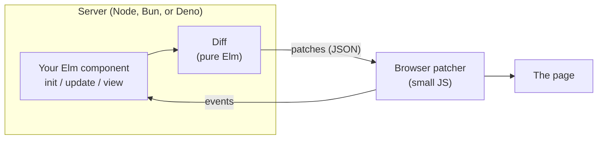

# Jorn

**Write your UI once in Elm. Run each piece in the browser, on the server, or both, and decide at deploy time. Ship new versions without your users noticing.**

Jorn is an attempt to build the web framework that doesn't make you choose. Today every serious option wins on one axis by giving up another. Jorn's bet is that with the right language, you can have all of them at once.

> **Status: v0.3.** You can build apps with Jorn and run them in the browser or on a Node server: every HTML, SVG and MathML element, attributes and ARIA, keyed lists, fragments, memoized subtrees, raw HTML, handlers that decide `preventDefault` for each event, effects, an app runtime, rendering to HTML strings, and server components that reconnect and catch up, on a pure Elm virtual DOM with a tested wire protocol and patcher. URL routing and server-side rendering are next. The rest of this page describes where it's going. See the [roadmap](ROADMAP.md).

## What v0.2 gives you

Apps in the Elm Architecture, on a virtual DOM that is ordinary Elm data, so a `view` can be diffed anywhere: in the browser, or on a server streaming patches to the browser.

```elm
port module Main exposing (main)

import Jorn
import Jorn.Element as Element exposing (Element)
import Jorn.Element.Html as Html
import Jorn.Event exposing (onClick)
import Json.Encode exposing (Value)

port toJorn : Value -> Cmd msg

port fromJorn : (Value -> msg) -> Sub msg

main : Jorn.Program () Int Msg
main =
    Jorn.simple
        { init = 0
        , update = update
        , view = view
        , ports = { toJorn = toJorn, fromJorn = fromJorn }
        }

type Msg
    = Increment

update : Msg -> Int -> Int
update Increment count =
    count + 1

view : Int -> Element Msg
view count =
    Html.button [ onClick Increment ] [ Element.text (String.fromInt count) ]
```

```js
import { start } from "./jorn.js";

start(Elm.Main, document.getElementById("app"));
```

Each click runs `update`, diffs the new view against the old one in Elm, and sends the page one patch: set the button's text.

The same program runs on a Node server without changes. `attach` from [`server/jorn.js`](server/jorn.js) runs one instance of it for each page, and `stream` shows it in the page over a websocket:

```js
attach(server, { path: "/app", program: Elm.Main });
```

```js
stream(document.getElementById("app"), "/app");
```

[server/README.md](server/README.md) covers the rest: flags, security, reconnects and limits, and what changes when commands run on the server.

| Module | What it does |
|---|---|
| `Jorn.Element`, `Jorn.Element.Html`, `Jorn.Attribute`, `Jorn.Event` | Build views. Ordinary Elm data, like `elm/html`. |
| `Jorn`, `Jorn.Effect` | Run an app in the page: `init`, `update`, `view`, and effects. |
| `Jorn.Patch` | Diff two views and encode the patches as JSON. |
| `Jorn.Navigation` | URL routing: `Browser.application` and `Browser.Navigation` for Jorn. |
| `Jorn.ServerComponent` | Put a server component anywhere in a page, as an element. |
| `Jorn.Static` | Describe a static site in Elm: pages from your views, and the files that go with them. |
| [`client/jorn.js`](client/jorn.js) | The browser side: apply patches to the DOM and report events back. No dependencies. |
| [`server/jorn.js`](server/jorn.js) | The server side: run a program on Node, one session per page, over a websocket. |
| [`cli/jorn.mjs`](cli/jorn.mjs) | `jorn build`: write a `Jorn.Static` site to a folder that any static host serves. |

[examples/todos](examples/todos) is a complete app, written the way Jorn apps are meant to be. Underneath, the page and the program only exchange JSON: events go in, and only what changed comes back out. A click and a keystroke look like this:

```
page -> app {"path":[4],"name":"click","event":{}}
app -> page {"patches":[{"op":"set-text","path":[3,0],"text":"1"}]}

page -> app {"path":[1],"name":"input","event":{"target":{"value":"Jorn"}}}
app -> page {"patches":[{"op":"set-text","path":[0,0],"text":"Hello, Jorn"},{"op":"set-attr","path":[1],"name":"value","value":"Jorn"}]}
```

That's what lets the same program run on a server, with a websocket in between.

The wire format is specified in [PROTOCOL.md](PROTOCOL.md).

### Using it

Jorn isn't on the Elm package registry yet. To try it, clone this repo, add its `src` folder to your application's `source-directories` in `elm.json` alongside a dependency on `elm/json` (and `elm/url`, for URL routing with `Jorn.Navigation`), and load `client/jorn.js` in your page. For server mode, also run `npm install` in `server/`. [examples/todos](examples/todos) shows the wiring, and `examples/serve.mjs` runs it both ways. To build an app as a static site, see [cli/README.md](cli/README.md) and [examples/site](examples/site).

## When to use it

As of v0.2, Jorn's strength is running an app on a server, or keeping that choice open. It's a good choice for:

- **Internal tools and admin dashboards.** `update` can query your database directly, so there's no API to build, and the page needs only a small script.
- **Widgets inside an existing site.** `<jorn-server-component>` drops a server-run component into a page from any stack: a quote calculator, a booking form, a support panel.
- **Logic that has to stay private.** Pricing rules, exam answers or licensed features never leave the server. The page sees only what they render.
- **Live status pages.** Each session fetches from your backends with `elm/http` and sends the page only what changed.
- **Apps that may move between the browser and the server.** In client mode the program runs in the page, and moving it to a server later changes how it's started, not the program. A client-mode app can also put server components in its view, so one page can mix both.

It's not a good choice, yet or at all, for:

- **Apps that will only ever run in the browser.** Plain Elm is better there for now: Jorn has no URL routing yet.
- **Views built with elm/html libraries** like elm-ui or elm-css. They produce elm/html's `Html`, which Jorn can't render.
- **Debugging with Elm's time-travel debugger.** It only works with `Browser` programs, and Jorn's aren't.
- **Offline-first apps, or users on slow or flaky connections.** In server mode, every click is a round trip.

Later versions widen this (see the [roadmap](#roadmap)):

- **v0.4:** URL routing, which makes browser-only apps a fair alternative to plain Elm. Also server-side rendering, for content sites with interactive parts, and sessions that can talk to each other, for chat and other live multi-user apps.
- **v0.5:** custom elements, for sharing Elm components with teams on React or Vue.

## The problem, in plain terms

When you build a web app today, you make an early, expensive decision about **where your UI runs**.

- **In the browser** (React, Vue, Svelte, classic Elm). Fast, interactive, works offline. But you ship a lot of JavaScript, you build an API layer to talk to your server, and you keep the two sides in sync by hand.
- **On the server** (Hotwire, Laravel Livewire, and the like). The server holds the state and streams small HTML updates over a websocket. Barely any client code and no API layer. But every click is a round trip, and when you deploy, connected users lose their session state.
- **A mix** (React Server Components, Next.js). Pick per component. In practice the boundary between "server" and "client" code is a constant source of bugs, because the language can't tell you what's safe to send across it.

And whichever you pick, you also maintain the glue: REST or GraphQL schemas, serializers, versioning, and deploy choreography so old clients don't break against new servers.

## The claim

Jorn aims to be the first framework that does all three of these together:

**1. Components that can run anywhere, unchanged.** The same component runs as a browser app, as a server component streaming updates, or as static HTML that wakes up in the browser. Moving it between those is a configuration change, not a rewrite. The compiler rejects any placement that would send something across the network that can't be sent.

**2. No API layer.** Client and server share types. The data that crosses the network is checked by the compiler, and the code to encode and decode it is generated. No REST endpoints to design, no schemas to keep in sync, no "the server changed and the client didn't" bugs in production.

**3. Deploys that don't drop anyone.** When you ship a new version, every connected user keeps their state. Their session is migrated to the new version through a migration function the compiler has proven handles every case. Today that's somewhere between hard and impossible in every mainstream framework.

The concrete bar: match the best server-component frameworks at live, server-rendered UI, Lamdera at type-safe full stack, and React at client-side apps, without making you choose between them up front.

## Why Elm makes this possible

If you've never used Elm: it's a small, purely functional language for web apps, best known for a compiler with famously friendly error messages and **no runtime exceptions in practice**. It invented the architecture that Redux and most modern state management copied.

The three ideas above are hard in most languages for the same reason: values can secretly hold things that don't survive a trip over the network or a version upgrade (open connections, mutable references, closures over live state). Elm doesn't allow that. In Elm:

- **Every piece of state is plain data**, so it can be sent to a browser, saved, or migrated to a new version.
- **Every side effect is a value** describing what should happen, not the act of doing it. So effects can be recorded, replayed, tested without mocks, and run on whichever machine the component lives on.
- **The compiler sees everything**, so it can prove the network boundary and the migrations are correct before you deploy.

Elm's syntax and guarantees are also, frankly, a joy. That matters: a framework is something you live in every day.

## "Isn't Elm dead?"

No. Elm went quiet for years after 0.19.1 in 2019, but Elm 0.19.2 shipped in July 2026 with faster builds, and Evan Czaplicki has laid out a path to Elm 1.0 as a series of small, non-breaking releases. Server-side Elm is a stated goal of the language.

Jorn is built to work with that direction, not around it. It needs nothing beyond what the compiler already provides, so it stays compatible as Elm moves toward 1.0. CI builds the package with both 0.19.1 and 0.19.2.

## For the Elm community: what this is not

**It's not a fork.** Jorn's Elm code is ordinary packages with no kernel code, playing by the package registry's rules. The pieces that can't be pure Elm (the browser patcher, the server runtime) live outside the Elm package graph, the same way elm-pages, elm-review, and Lamdera's tooling do. Elm's guarantees stay intact.

**It's not a replacement for `elm/html`.** If you're building a normal browser app, `elm/html` is great. Jorn has its own `Element` type because `elm/html` values are opaque and can only be rendered by the browser runtime. Jorn's are ordinary data, so they can be compared and diffed anywhere, including on a server.

**It's not a new architecture.** It's The Elm Architecture (`init`, `update`, `view`), extended so `view` can run somewhere other than the browser.

## How it works



Your component's `view` produces a tree of plain Elm data. When state changes, Jorn compares the old tree with the new one and produces a small list of patches ("set this text," "add this attribute," "append these children"). A tiny script in the browser applies them to the page and reports user events back.

The important part: **the browser runs the exact same pipeline.** In client mode, the component runs in the browser and sends patches to the same patcher, locally. One rendering path, one protocol, everywhere. That's what makes moving a component between server and client a configuration change.

On the server, a small JavaScript runtime runs each connected user's session as its own instance of your Elm program, snapshots session state, and migrates it across deploys. Because Elm code doesn't crash at runtime, a lost session is simply restarted from its last snapshot.

## Roadmap

| Version | What | Status |
|---|---|---|
| v0.0 | Pure Elm virtual DOM, diff, wire protocol, event routing, and the browser patcher | **Done** |
| v0.1 | Full HTML and SVG coverage, keyed lists, effects, and an app runtime | **Done** |
| v0.2 | Server components: a Node runtime over a websocket, with reconnects, limits and elm/http | **Done** |
| v0.2.1 | MathML elements, raw HTML, rendering to HTML strings, and form submits with their fields | **Done** |
| v0.3 | The rest of the view layer: memoized subtrees and per-event `preventDefault` | **Done** |
| v0.4 | Server-side rendering and hydration, URL routing, server-sent events and polling, messaging a running app from JavaScript | Next |
| v0.5 | Components as custom elements: shadow DOM, slots, forms, lifecycle and contexts | Planned |
| v0.6 | A dev server and build command, querying and simulating apps in tests, and the JavaScript written in TypeScript | Planned |
| v1.0 | The full feature set, published to the Elm package registry | Planned |
| After 1.0 | Generated encoders for types shared by the browser and the server, sessions kept across deploys with typed migrations, REST endpoints written in Elm, and Bun and Deno | Future work |

Server components already need no API layer: `update` runs on the server, and only events and patches cross the network. After 1.0, generated encoders bring the same to apps running in the browser, and typed migrations let a deploy keep every session. Those finish the "no API layer" and "deploys that don't drop anyone" parts of the claim above, once the full feature set is done. Throughout, the aim is for Jorn to be as fast as Elm allows. Feature-by-feature status is in [ROADMAP.md](ROADMAP.md).

## Standing on shoulders

Jorn exists because of work it borrows from directly.

- **[Elm](https://elm-lang.org)** and The Elm Architecture, which make everything above possible.
- **[Lamdera](https://lamdera.com)** proved typed, schema-free client/server communication and type-checked migrations ("Evergreen") in Elm.
- **[elm-pages](https://elm-pages.com)** proved full-stack Elm with server rendering and hydration, without forking the language's guarantees.

## Contributing

Issues and pull requests are welcome. See [CONTRIBUTING.md](CONTRIBUTING.md) for setup and how the tests pin the wire format.

## License

[BSD-3-Clause](LICENSE)
